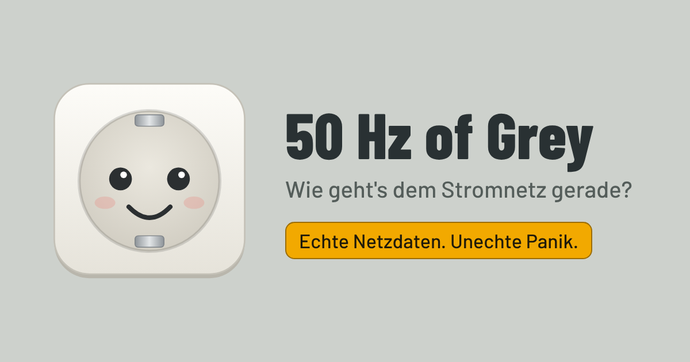

# ⚡ 50 Hz of Grey

**Wie geht's dem deutschen Stromnetz gerade?** Eine Steckdose mit Gefühlen erklärt es dir – mit echten Messwerten und unechter Panik.

👉 **Live:** https://fbw159.github.io/50hz-of-grey/



## Was drin ist

Eine einzige Seite, gebaut fürs Handy:

- **Die Steckdose** zeigt die Laune des Netzes: tiefenentspannt, entspannt, leicht nervös, am Schwitzen oder in Panik. Antippen erlaubt.
- **Panik-Index (0–100):** ein Spaß-Index aus drei echten Werten – Abweichung der Frequenz von 50 Hz, Börsenstrompreis und wie wenig Wind und Sonne gerade liefern.
- **Drei Messgeräte:** Netzfrequenz, Börsenstrompreis, Öko-Anteil.
- **Der Herzschlag des Netzes:** die Frequenz der letzten zehn Minuten als EKG.
- **Was kostet Strom gerade?** Börsenpreis jetzt, Stundenbalken für heute und morgen und der Waschmaschinen-Tipp (billigste und teuerste Stunde).
- **Wer liefert gerade den Strom?** Sonne, Wind, Kohle, Gas & Co. mit je einem Spruch.
- **Spiel „Halt die 50 Hz!“:** 45 Sekunden Leitwarte – Halbzeitpausen, Wolken und Sturmtiefs mit dem Kraftwerk ausgleichen.
- **Wusstest du?** Kurze, echte Fakten zum Stromnetz.

## Woher die Zahlen kommen

Alle Messwerte stammen von [Energy-Charts](https://www.energy-charts.info) (Fraunhofer ISE), Lizenz CC BY 4.0:
Netzfrequenz (Sekundenwerte, gemessen in Freiburg), Day-Ahead-Preis DE-LU, öffentliche Nettostromerzeugung und installierte Leistung.

Die API erlaubt keine direkten Abrufe aus fremden Webseiten (CORS). Deshalb holt ein **GitHub-Actions-Workflow** die Daten regelmäßig ab
(`scripts/update-data.mjs`, im Takt der API-Limits), legt sie als `data/latest.json` neben die Seite und veröffentlicht neu.
GitHub startet geplante Läufe nicht exakt, in der Praxis kommen neue Werte etwa alle 30 bis 45 Minuten.

Ehrlichkeitsregeln:

- Jeder Wert zeigt seine Uhrzeit. Erzeugungsdaten kommen bei Energy-Charts ca. 1–2 Stunden verzögert.
- Fehlen Daten, sagt die Seite das. **Beispieldaten** gibt es nur auf Knopfdruck und dann mit gelb-schwarzem Warnbanner.
- Die Sprüche sind Satire, die Zahlen nicht. Der Panik-Index ist keine offizielle Kennzahl.

## Lokal starten

```bash
npm install
npm run dev          # http://localhost:5173/50hz-of-grey/ – im Dev-Modus mit Live-Daten über einen Proxy
npm run update-data  # echten Snapshot nach public/data/latest.json holen (dauert 2–3 Minuten)
npm run build        # Produktions-Build nach dist/
npm run preview      # Build ansehen
```

## Tests

```bash
npm test             # Unit-Tests (Vitest): Rechenlogik, Datenschicht, Spielphysik
npm run test:e2e     # Browser-Tests (Playwright) auf Handy- und Desktop-Größe
npm run lint
```

## Projektstruktur

```
src/
  App.tsx              die Seite
  components/          Steckdose, Messgeräte, Karten, Spiel
  content/texts.ts     alle Sprüche und Fakten an einem Ort
  logic/               Panik-Index, Preise, Strommix, Frequenz, Spielphysik (alles getestet)
  services/            Datenabruf: Snapshot, Cache, Live-API (Dev)
  lib/                 Formatierung, Zeit (Europe/Berlin), Zeitreihen
scripts/
  update-data.mjs      holt die Daten (GitHub Actions)
  generate-icons.mjs   Icons und Vorschaubild
.github/workflows/
  deploy.yml           Daten holen, bauen, auf GitHub Pages veröffentlichen
  ci.yml               Lint, Unit- und Browser-Tests
```

## Veröffentlichen

Push auf `main` reicht. In den Repository-Einstellungen muss unter **Settings → Pages → Source** „GitHub Actions“ ausgewählt sein.
Heißt das Repository anders, wird der Pfad automatisch aus dem Repo-Namen gesetzt.

## Datenschutz

Keine Cookies, kein Tracking, keine externen Schriften oder Skripte. Der Spielrekord liegt nur im eigenen Browser.

## Lizenzen

Code: MIT. Daten: Energy-Charts (Fraunhofer ISE), CC BY 4.0. Schriften: Barlow und Barlow Condensed (SIL OFL), DSEG7 von keshikan (SIL OFL). Icons: Lucide (ISC).
